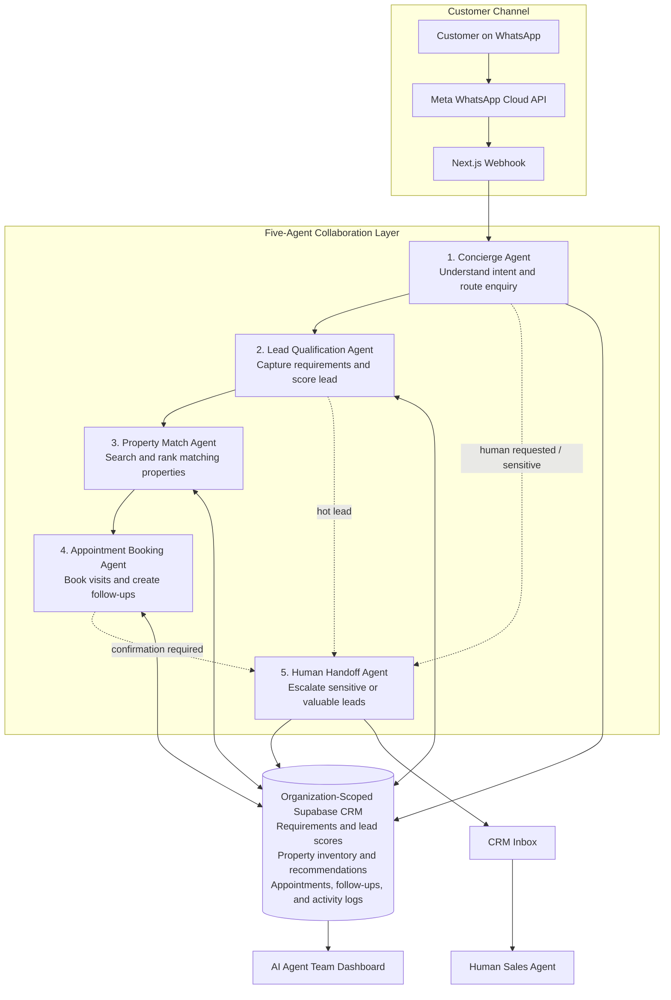

# Real Estate Multi-Agent Architecture

## Overview

The system extends `huygen-warp` into an organization-based WhatsApp CRM for real estate agencies. Each agency is an organization with members assigned one of four roles: `owner`, `admin`, `manager`, or `agent`.

Core stack:

- Next.js 16 App Router and React 19
- Supabase Auth, Postgres, RLS, and Realtime
- Meta WhatsApp Business Cloud API
- Existing WhatsApp Flow engine
- n8n webhook workflows through a durable event outbox

## Tenancy and RLS

Migration `20260701000000_organizations_real_estate.sql` adds:

- `organizations`
- `organization_members`
- `is_organization_member(organization_id)`
- `has_organization_role(organization_id, roles)`
- `organization_id` on CRM, n8n, flow, automation, and real-estate tables

Existing user-owned CRM rows are backfilled into a safely derived legacy organization for that user. Legacy n8n rows have no owner signal, so they are quarantined by setting `is_active = false` and leaving `organization_id = null`.

Database isolation:

- Members can read records only for their organizations.
- Managers/admins/owners can manage organization settings, n8n workflows, properties, automations, and flows.
- n8n settings and workflows require non-null `organization_id`.
- Sensitive n8n values are never returned in plaintext by normal APIs.

API isolation:

- Route handlers call `requireOrganizationContext`.
- The server resolves the authenticated user and active organization.
- Browsers never send trusted organization IDs for protected writes.

## Five-Agent Workflow

The system uses five deterministic, specialized agents in `src/lib/real-estate/agents.ts`.

Concierge Agent:

- Reads each inbound WhatsApp message and identifies the customer's intent.
- Routes the enquiry to the appropriate specialist agent.
- Uses the Meta message ID as an idempotency key.
- Skips automation when a conversation is human-owned.
- Logs intent, reason, confidence, and output summary.

Lead Qualification Agent:

- Extracts preferred location, budget, property type, bedrooms, sale/rent intent, timeline, financing interest, and site-visit interest.
- Scores leads using explainable rules:
  - location: 15
  - budget: 20
  - property type: 15
  - timeline: 20
  - site visit: 20
  - verified contact: 10
- Categories are `hot`, `warm`, `cold`, and `general_enquiry`.

Property Match Agent:

- Reads only available properties for the active organization.
- Scores matches by listing type, property type, location/locality, bedrooms, and budget.
- Stores up to three recommendations with reasons.
- Selects a property-specific or representative image from the configured
  Google Drive folder and sends it through the CRM's authenticated Meta media
  upload path.

Appointment Booking Agent:

- Handles requests to visit a property and creates the appointment request.
- Records the customer's preferred appointment date and time.
- Does not claim confirmation until a human confirms.
- Creates follow-up tasks until the appointment is confirmed.
- The current implementation stores task state internally; scheduled reminders can be connected through n8n.

Human Handoff Agent:

- Escalates hot leads, sensitive topics, legal/loan/negotiation requests, unknown intents, and explicit human-support requests.
- Assigns the least-loaded eligible member when possible.
- Sets `automation_mode = human` on the conversation.

The live command center at `/agents` reads the organization-scoped `agent_activity_logs` audit trail and displays each agent's recent runs, confidence, last action, and cross-agent flow.

### Five-Agent Architecture

## n8n Event Dispatch

`dispatchN8nEvent` enqueues records in `event_outbox`.

`GET /api/n8n/dispatch/cron` drains due events and delivers to matching active organization-scoped n8n workflows. The endpoint uses `AUTOMATION_CRON_SECRET` through `x-cron-secret`.

Payloads include:

- organization ID
- event type
- entity type and ID
- idempotency key
- sanitized payload
- timestamp

Outbound webhooks include:

- `X-Huygen-Timestamp`
- `X-Huygen-Idempotency-Key`
- `X-Huygen-Delivery-Id`
- `X-Huygen-Signature` when a workflow secret is configured

## Environment Variables

Required:

- `NEXT_PUBLIC_SUPABASE_URL`
- `NEXT_PUBLIC_SUPABASE_ANON_KEY`
- `SUPABASE_SERVICE_ROLE_KEY`
- `ENCRYPTION_KEY`
- `META_APP_SECRET`

Recommended:

- `NEXT_PUBLIC_SITE_URL`
- `AUTOMATION_CRON_SECRET`

Optional:

- `N8N_WHATSAPP_FORWARD_WEBHOOK_URL`
- `N8N_WHATSAPP_FORWARD_SECRET`
- `N8N_INTERNAL_SECRET`
- `GOOGLE_DRIVE_API_KEY`
- `GOOGLE_DRIVE_IMAGE_FOLDER_ID`

## Local Development

1. Install dependencies with `npm install`.
2. Copy `.env.local.example` to `.env`.
3. Fill Supabase, Meta, and encryption values.
4. Apply Supabase migrations.
5. Run `npm run dev`.
6. Add organization-scoped n8n workflows from `/n8n-workflows`.

## Demo Walkthrough

1. Create or sign in as an agency user.
2. Add properties from `/properties`.
3. Configure WhatsApp settings.
4. Send a WhatsApp message such as: `Looking for 2BHK flat in Whitefield under 90 lakh this month. Can I schedule a site visit?`
5. The webhook persists the message, classifies intent, updates lead requirements, scores the lead, recommends matching properties, creates an appointment request, creates a follow-up task, logs agent activity, and enqueues n8n events.
6. View the site-visit request in `/appointments`.
7. Confirm or cancel the appointment manually.

## Security Considerations

- Service-role Supabase access stays server-only.
- n8n API keys and workflow secrets are encrypted using the existing AES-GCM utility.
- Normal n8n API responses expose `hasSecretConfigured`, `hasApiKeyConfigured`, and masked webhook URLs only.
- The Meta webhook signature validation remains intact.
- Proxy route protection is only an optimistic guard; route handlers and RLS enforce authorization.

## Future Extensions

- Calendar adapter for Google Calendar or Outlook.
- Rich contact lead profile panel across all contact views.
- AI provider interface for optional summarization or intent assistance.
- More advanced quiet-hour scheduling for outbound follow-up sends.
- Bulk property import from CSV.
